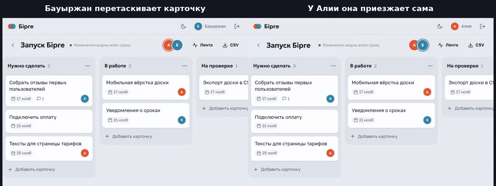
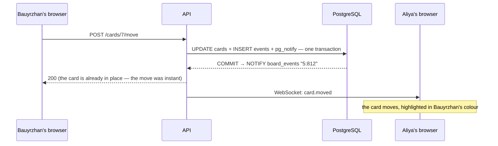

# Birge — a task board where the whole team sees the same thing

[](https://github.com/A160LKN/birge/actions/workflows/ci.yml)

[Русский](README.md) · **English**

A fullstack app with boards, columns and cards that update for every member in real time. A teammate drags a card — on your screen it moves in the same second, highlighted in their colour and labelled with their name. Two people edit the same description — nobody's text is silently overwritten. Image attachments get thumbnails and boards export to CSV, all in the background.

_Birge_ means "together" in Kazakh.

**Backend:** FastAPI (async), PostgreSQL, WebSocket, a background job queue on PostgreSQL
**Frontend:** React 19, TypeScript, TanStack Query, dnd-kit
**Tests:** 214 backend, 83 frontend, 14 E2E running in two browsers at once, including accessibility checks (axe) in light and dark themes



**[Open Birge →](https://birge-seven.vercel.app)** · [API docs](https://birge-api-j4n8.onrender.com/docs). The server runs on a free tier and sleeps when idle, so the first load can take up to a minute. The interface is in Russian.

**Try it with two users:** open the site in two browsers and sign in as `aliya@birge.kz` and `bauyrzhan@birge.kz`, password `birge-demo`.

## Features

- boards, members by invitation, columns and cards; cards can be dragged with a mouse, a finger or the keyboard;
- **real time**: every change arrives over WebSocket, and you can see who is on the board right now;
- **nothing is lost after a dropped connection**: the client reconnects and receives the missed events starting from the last one it saw;
- **optimistic locking**: a card edit carries its version; if the card has already changed, the API returns `409` with the current version and the user decides what to keep;
- **files up to 5 MB**: the type is detected by content, not by extension; image thumbnails are generated in the background;
- **CSV export** is prepared in the background, and an event announces when it is ready;
- activity feed, assignees, due dates, comments, light and dark themes.

## How real time works



- **The event is written to the log in the same transaction as the change**, and `pg_notify` fires only after commit. If the change is rolled back, nobody hears about it; if it is saved, nobody misses it.
- **LISTEN/NOTIFY instead of Redis**: each API process listens to PostgreSQL itself, so events are delivered even with several processes. Everything fits into free hosting.
- **No gap between loading and subscribing**: the board is returned together with `last_event_id`, and the WebSocket sends everything after it.
- **The token goes in the first socket message, not in the URL**: URLs end up in server and proxy logs.
- A removed member is disconnected immediately (code 4403); when a board is deleted, everyone is disconnected (4404).
- The client reconnects with growing, jittered delays, checks that the connection is alive with ping, and does not hammer the server while offline.

## Design decisions worth knowing

- **Card order uses fractional keys** (fractional indexing): to put a card between two others you only need a key between their keys; no other cards are touched. The same algorithm in the browser gives an instant move before the server responds. Both implementations are checked against shared examples in [`shared/position-vectors.json`](shared/position-vectors.json), read by backend and frontend tests. Keys use `COLLATE "C"` in PostgreSQL: with language-aware collation, "a" and "B" would sort differently.
- **The background job queue is a PostgreSQL table** with `SELECT … FOR UPDATE SKIP LOCKED`: two workers never take the same job, the work and the "done" mark commit together, failures are retried with growing delays, and stuck jobs are picked up again.
- **Files**: type by signature, the extension must match the content (an SVG with a script will not pass), the name is stripped of paths, and downloads are served with `nosniff` and `sandbox`. Browsers load images with an `` tag without an auth header, so links are signed with HMAC and expire in an hour.
- **CSV**: protected against formula injection (`=HYPERLINK(…)` will not become a formula in Excel), with a BOM and `;` separator for Russian locale Excel, times in Astana time.
- **Access**: someone else's board returns `404`, not `403`, so board IDs cannot be probed.

## Tests

| Level                         | Count | What they check                                                                                                                                                                                                                  |
| ----------------------------- | ----- | -------------------------------------------------------------------------------------------------------------------------------------------------------------------------------------------------------------------------------- |
| Backend: unit                 | 78    | fractional keys (including hundreds of random sequences via Hypothesis), tokens and signed links, file validation, thumbnails, CSV injection                                                                                     |
| Backend: integration          | 17    | on real PostgreSQL: 5 workers on one queue — each job runs exactly once; retries and delays; transactional events; key sorting in the database; a dropped LISTEN connection; migrations down and up                              |
| Backend: API and WebSocket    | 120   | brute-force protection and security headers, permissions, version conflicts, card order, uploads, export; socket auth, presence, catch-up after reconnect, disconnecting a removed member                                        |
| Frontend: unit and components | 83    | applying events to data, move calculation, socket reconnection (delays, ping, offline), the edit-conflict screen, live events through a mocked WebSocket                                                                         |
| E2E                           | 14    | accessibility (axe, WCAG 2.1 AA) in light and dark themes; **two browsers at once**: one user's card appears for the other, drag and drop, presence, edit conflict; thumbnail from a background job; CSV download; mobile layout |

Backend coverage is 98 %, frontend 89 % of lines.

More detail (in Russian) in the [test documentation](docs/testing/README.md): test strategy with risk analysis, a coverage matrix of 19 features, smoke and regression checklists.

### What the tests found

| Where             | What was wrong                                                                                                                               | Found by                       |
| ----------------- | -------------------------------------------------------------------------------------------------------------------------------------------- | ------------------------------ |
| Removing a member | `500`: `FOR UPDATE` does not work with `LEFT JOIN`, and the ORM loaded the user exactly that way                                             | API test                       |
| CSV export        | the change time was in UTC — 5 hours behind Astana                                                                                           | API test                       |
| Mobile layout     | a hidden screen-reader label stretched the page, so it could be scrolled sideways on a phone                                                 | E2E on a phone                 |
| Live site (Neon)  | events did not arrive: `LISTEN` went through the connection pooler (PgBouncer), which silently drops notifications; now it connects directly | browser check after deploy     |
| Resilience test   | it also killed LISTEN connections of a neighbouring server: `pg_stat_activity` sees all databases                                            | the test itself — filter fixed |

## Running locally

Requires Docker and Node.js 20+.

```bash
docker compose up --build --wait     # PostgreSQL and the API at http://localhost:8000 (docs at /docs)
cd frontend && npm install && npm run dev   # http://localhost:5173
```

Tests:

```bash
cd backend && pip install -r requirements-dev.txt && pytest --cov=app   # needs the database from docker compose
cd frontend && npm test                 # unit and component tests
cd frontend && npm run test:e2e         # E2E against the API at localhost:8000
```

## CI

1. **Backend** — ruff and pytest on PostgreSQL with a coverage threshold.
2. **Frontend** — checks that types match the API schema, TypeScript, ESLint, Prettier, tests, build.
3. **E2E** — the API with the job worker on PostgreSQL, schema check against the running server, Playwright.
4. **Docker** — image build, `docker compose up` and a smoke test: health, demo user sign-in, board.
