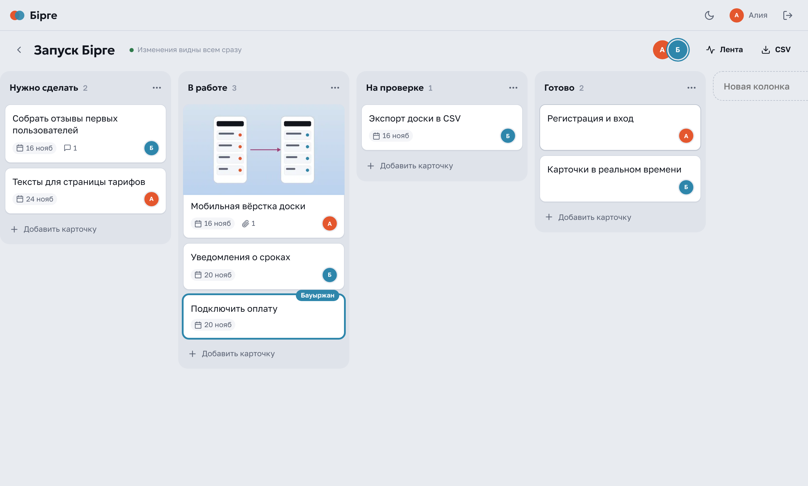
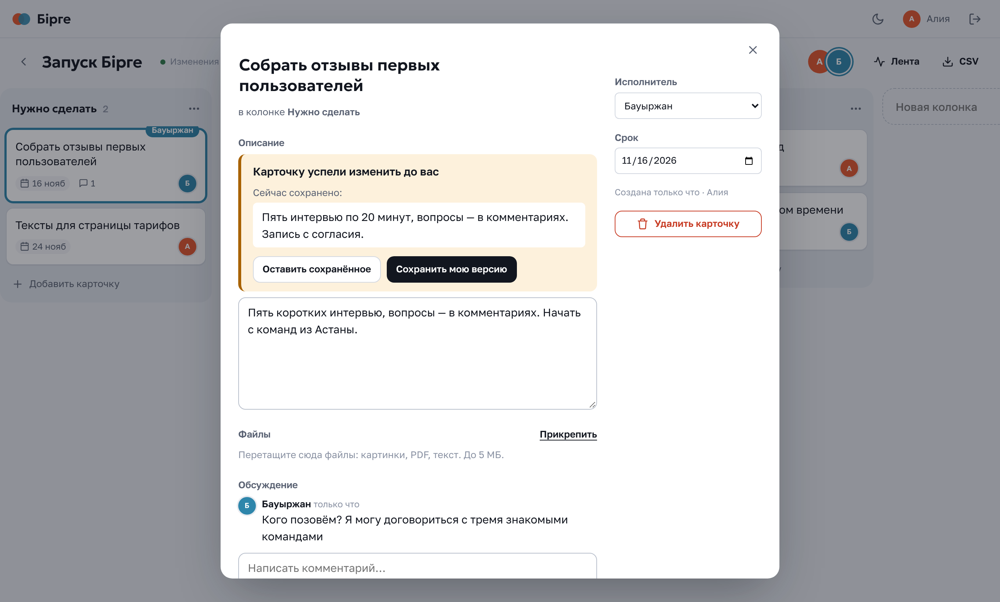
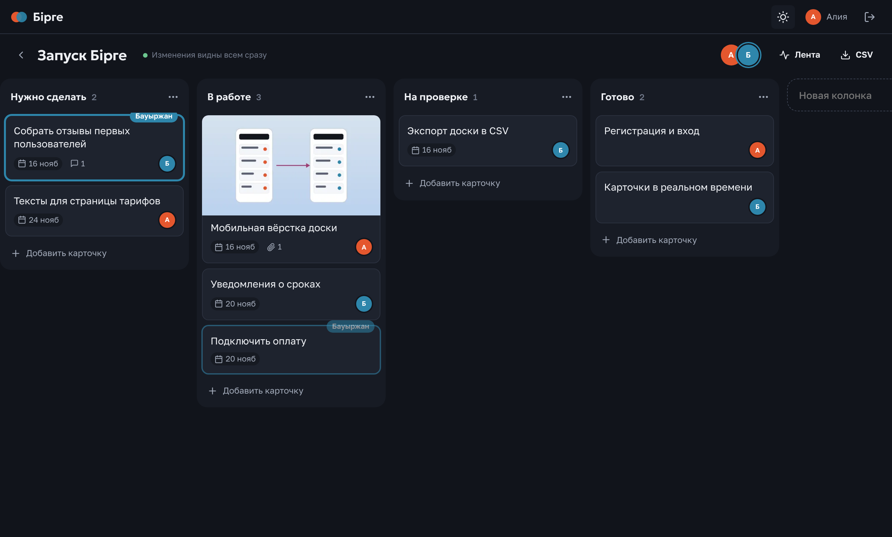
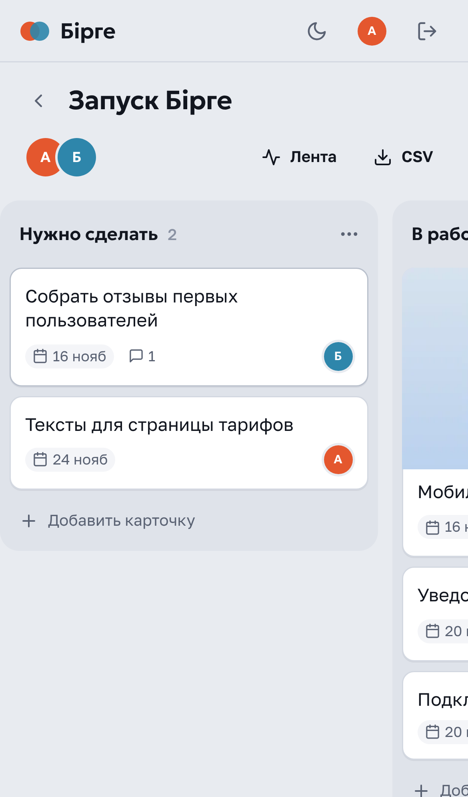
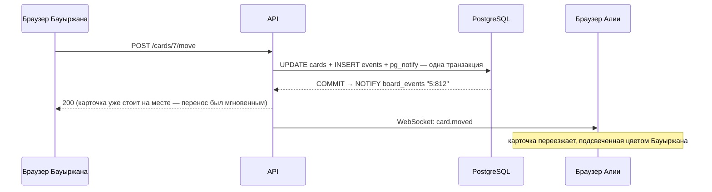

# Бірге — доска задач, на которой команда видит одно и то же

[](https://github.com/A160LKN/birge/actions/workflows/ci.yml)

Fullstack-приложение: доски с колонками и карточками, которые обновляются у всех участников в реальном времени. Коллега перетащил карточку — у вас она переехала в ту же секунду, подсвеченная его цветом и подписанная его именем. Двое правят одно описание — никто не затрёт чужой текст молча. Картинки во вложениях получают превью, доска выгружается в CSV — всё это в фоне.

**Бэкенд:** FastAPI (async), PostgreSQL, WebSocket, очередь фоновых задач на PostgreSQL
**Фронтенд:** React 19, TypeScript, TanStack Query, dnd-kit
**Тесты:** 196 на бэкенде, 83 на фронтенде, 12 E2E в двух браузерах одновременно



| Конфликт правок                                   | Тёмная тема                               | Телефон                                 |
| ------------------------------------------------- | ----------------------------------------- | --------------------------------------- |
|  |  |  |

**[Открыть Бірге →](https://birge-seven.vercel.app)** · [документация API](https://birge-api-j4n8.onrender.com/docs). Сервер на бесплатном хостинге засыпает после простоя, поэтому первая загрузка может идти до минуты.

**Попробовать вдвоём:** откройте сайт в двух браузерах и войдите как `aliya@birge.kz` и `bauyrzhan@birge.kz`, пароль `birge-demo`.

## Что умеет

- доски, участники по приглашению, колонки и карточки; карточки перетаскиваются мышью, пальцем и с клавиатуры;
- **реальное время**: все изменения приходят по WebSocket, видно, кто сейчас на доске;
- **после обрыва связи ничего не теряется**: клиент переподключается и получает пропущенные события по номеру последнего;
- **оптимистическая блокировка**: правка карточки приходит с версией; если карточку уже изменили — `409` и актуальная версия, человек сам выбирает, что оставить;
- **файлы до 5 МБ**: тип определяется по содержимому, а не по расширению; превью картинок готовится в фоне;
- **выгрузка в CSV** готовится в фоне, о готовности приходит событие;
- лента действий, исполнители, сроки, комментарии, светлая и тёмная темы.

## Как устроено реальное время



- **Событие пишется в журнал в той же транзакции, что и изменение**, а `pg_notify` срабатывает только после коммита. Откатилось изменение — никто о нём не узнает; сохранилось — никто не пропустит.
- **LISTEN/NOTIFY вместо Redis**: каждый процесс API слушает PostgreSQL сам, поэтому события доходят и при нескольких процессах. Всё помещается в бесплатный хостинг.
- **Без дыры между загрузкой и подпиской**: доска отдаётся вместе с `last_event_id`, и WebSocket досылает всё, что было после него.
- **Токен — в первом сообщении сокета, а не в адресе**: адреса оседают в логах серверов и прокси.
- Удалённого участника сервер отключает сразу (код 4403), доску удалили — отключает всех (4404).
- Клиент переподключается с растущей паузой и случайным разбросом, проверяет «живость» соединения через ping и не стучится в сервер, пока нет интернета.

## Решения, о которых стоит знать

- **Порядок карточек — дробные ключи** (fractional indexing): чтобы поставить карточку между двумя, нужен ключ между их ключами, остальные карточки не трогаются. Тот же алгоритм в браузере даёт мгновенный перенос до ответа сервера; совпадение реализаций проверяют общие примеры в [`shared/position-vectors.json`](shared/position-vectors.json) — их читают тесты и бэкенда, и фронтенда. В PostgreSQL у ключей `COLLATE "C"`: с правилами сортировки языка «a» и «B» встали бы в другом порядке.
- **Очередь фоновых задач — таблица в PostgreSQL** с `SELECT … FOR UPDATE SKIP LOCKED`: одну задачу не возьмут два обработчика, работа и отметка «выполнена» коммитятся вместе, ошибка — повтор с растущей паузой, зависшая задача подхватывается снова.
- **Файлы**: тип по сигнатуре, расширение должно совпадать с содержимым (SVG со скриптом не пройдёт), имя очищается от пути, отдача с `nosniff` и `sandbox`. Картинки браузер грузит тегом `` без заголовка авторизации — поэтому ссылки подписаны HMAC и живут час.
- **CSV**: защита от формул (`=HYPERLINK(…)` не станет формулой в Excel), BOM и разделитель «;» для русской локали, время — астанинское.
- **Доступ**: чужая доска — `404`, а не `403`, чтобы по номерам нельзя было узнать, какие доски существуют.

## Тесты

| Уровень                     | Сколько | Что проверяют                                                                                                                                                                                              |
| --------------------------- | ------- | ---------------------------------------------------------------------------------------------------------------------------------------------------------------------------------------------------------- |
| Бэкенд: юнит                | 75      | дробные ключи (в том числе сотни случайных последовательностей через Hypothesis), токены и подписи ссылок, проверка файлов, превью, CSV-инъекции                                                           |
| Бэкенд: интеграционные      | 17      | на настоящем PostgreSQL: 5 обработчиков на одной очереди — каждая задача ровно один раз; повторы и паузы; транзакционность событий; сортировка ключей в БД; обрыв соединения LISTEN; миграции вниз и вверх |
| Бэкенд: API и WebSocket     | 104     | права доступа, конфликт версий, порядок карточек, загрузка файлов, выгрузка; авторизация сокета, присутствие, догонялка после обрыва, отключение удалённого участника                                      |
| Фронтенд: юнит и компоненты | 83      | применение событий к данным, расчёт переноса, переподключение сокета (паузы, ping, офлайн), конфликт правок в интерфейсе, живые события через мок WebSocket                                                |
| E2E                         | 12      | **два браузера одновременно**: карточка одного появляется у другого, перетаскивание, присутствие, конфликт правок; превью из фоновой задачи; скачивание CSV; мобильная вёрстка                             |

Покрытие бэкенда — 98 %, фронтенда — 89 % строк.

### Что нашли тесты

| Где                | Что было                                                                                               | Кто нашёл                   |
| ------------------ | ------------------------------------------------------------------------------------------------------ | --------------------------- |
| Удаление участника | `500`: `FOR UPDATE` не работает с `LEFT JOIN`, а ORM подгружал пользователя именно так                 | API-тест                    |
| Выгрузка CSV       | время изменения по UTC — на 5 часов раньше астанинского                                                | API-тест                    |
| Мобильная вёрстка  | невидимая подпись для экранных дикторов растягивала страницу — на телефоне её можно было сдвинуть вбок | E2E на телефоне             |
| Тест устойчивости  | обрывал соединения LISTEN и у соседнего сервера: `pg_stat_activity` видит все базы                     | сам тест — исправлен фильтр |

## Запуск

Нужны Docker, Node.js 20+.

```bash
docker compose up --build --wait     # PostgreSQL и API на http://localhost:8000 (документация — /docs)
cd frontend && npm install && npm run dev   # http://localhost:5173
```

Тесты:

```bash
cd backend && pip install -r requirements-dev.txt && pytest --cov=app   # нужна база из docker compose
cd frontend && npm test                 # юнит и компоненты
cd frontend && npm run test:e2e         # E2E против API на localhost:8000
```

## Структура

```
backend/
├── app/routers       — HTTP: доски, карточки, вложения, вход
├── app/services      — бизнес-логика и права доступа
├── app/realtime      — журнал событий, рассылка (LISTEN/NOTIFY), WebSocket
├── app/jobs          — очередь фоновых задач, превью, выгрузка
├── app/positions.py  — дробные ключи порядка
└── tests             — юнит, интеграционные, API и WebSocket
frontend/
├── src/realtime      — сокет с переподключением и применение событий к кешу
├── src/board         — доска, перетаскивание, карточка
└── e2e               — Playwright, два браузера
shared/               — общие примеры для алгоритма позиций
```

## CI

1. **Бэкенд** — ruff и pytest на PostgreSQL с порогом покрытия.
2. **Фронтенд** — проверка, что типы совпадают со схемой API, TypeScript, ESLint, Prettier, тесты, сборка.
3. **E2E** — API с обработчиком задач на PostgreSQL, сверка схемы с работающим сервером, Playwright.
4. **Docker** — сборка образа, `docker compose up` и смоук: здоровье, вход демо-пользователя, доска.
